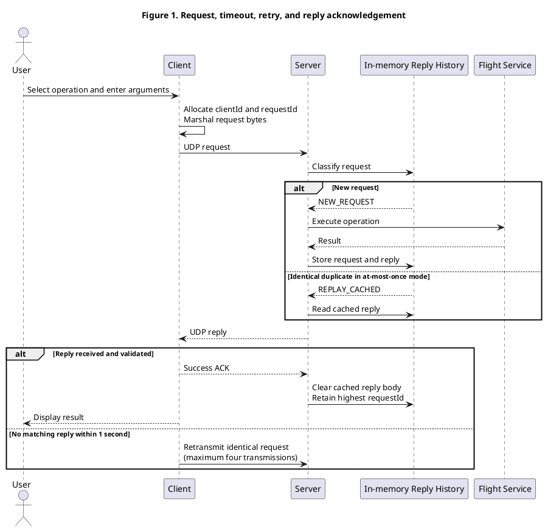
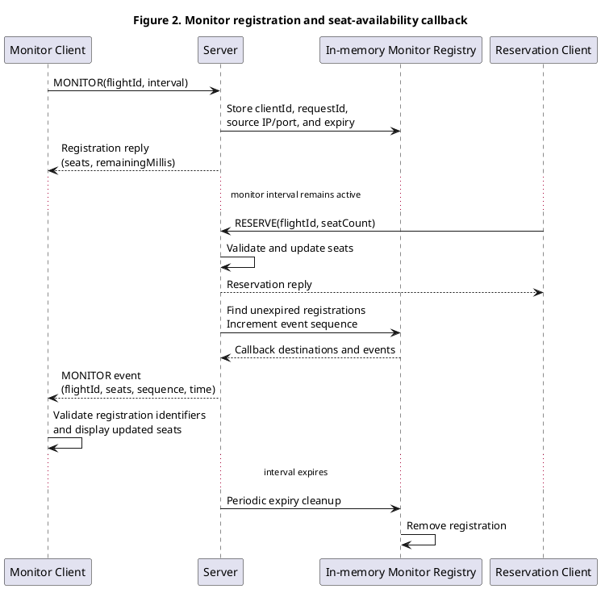
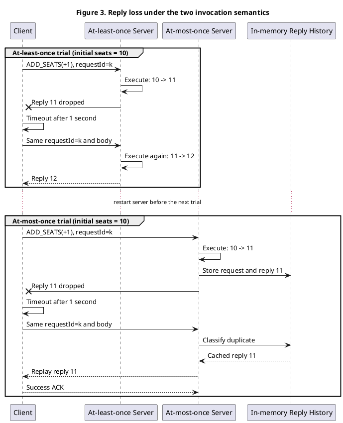

# Design and Implementation of a Distributed Flight Information System

Course Project Report  |  2026-2027 Trimester 1

| **Group member** | **Matriculation number** | **Contribution** | **Main responsibility** |
| --- | --- | --- | --- |
| WU ZIYUAN | G2601984E | 35% | Protocol design, byte encoding, cross-language format, and integration coordination. |
| FANG XIAOMING | G2606187F | 25% | Java server, flight data, business validation, and invocation-history semantics. |
| CAI BINGYI | G2601886H | 20% | Client interfaces, request/reply handling, retry logic, and C client compatibility. |
| LIU ZIHAO | G2606308A | 20% | Timed monitor callbacks, deterministic loss simulation, demonstration procedure, and report assembly. |

Submission deadline: 14 October 2026

## Abstract

This project implements a distributed flight information system over UDP. A Java server owns the in-memory flight catalogue and exposes six operations through a console client: route search, flight details, seat reservation, timed seat monitoring, fare setting, and seat addition. The application defines a compact byte protocol and manually marshals every field, including variable-length UTF-8 strings and IEEE 754 single-precision fares. A Java client and a C client use the same wire format.

The design addresses UDP message loss with one-second timeouts and up to four transmissions. The server can run with at-least-once or at-most-once invocation semantics. A deterministic loss simulator drops the first request or reply for each ADD_SEATS request, allowing the effect of retries on a non-idempotent operation to be compared. For at-most-once execution, the server retains the latest reply per client instance, replays it for a duplicate request, and protects against old requests after the reply body is cleared. Timed monitoring uses server-observed source endpoints, monotonic deadlines, and callback datagrams carrying event sequence numbers.

The report explains how the implementation maps to the course requirements, documents the protocol and operation semantics, and analyzes the deterministic loss experiments. The design deliberately keeps flight data in memory and makes the server authoritative; consequently, changes reset on server restart and the at-most-once guarantee is scoped to one server process lifetime.

## 1. Project Objective and Scope

The project implements a UDP client-server flight information service with manual marshalling, failure handling, and two remote invocation semantics. The delivered system uses Java 17 for the server and Java client, while an additional C client implements the same wire protocol. The service maintains flight state and seat availability but does not model passenger identities, payment, persistent reservations, or durable booking records.

## 2. Requirement Compliance

Table 1 maps each required capability to the corresponding implementation. The project includes all four required services, two additional operations with different idempotence properties, loss simulation, and both invocation modes.

| **Course requirement** | **Implementation** |
| --- | --- |
| UDP client-server communication | Java DatagramSocket and DatagramPacket; server endpoint supplied at client startup. |
| Find flight IDs by source and destination | ROUTE filters normalized route names, sorts IDs, and returns pages of up to 100. |
| Query departure, fare, and seats | DETAILS returns UTC epoch seconds, float32 fare, and available-seat count. |
| Reserve seats and report errors | RESERVE validates the flight and positive count, checks availability, and updates server state. |
| Timed callback monitoring | MONITOR records source IP/port and a monotonic expiry; seat changes produce callback datagrams. |
| Additional idempotent operation | SET_FARE assigns an absolute fare; repeating the same value leaves state unchanged. |
| Additional non-idempotent operation | ADD_SEATS increments the available-seat count by a positive amount. |
| Manual marshalling and unmarshalling | Protocol.java/MessageCodec.java and the C protocol module encode byte arrays by field offset. |
| At-least-once and at-most-once semantics | Server startup selects the mode; retries preserve clientId, requestId, operation, and body. |
| Simulate request and reply loss | The optional server mode drops the first ADD_SEATS request or reply for each request key. |
| Concurrent clients and console use | The server accepts successive UDP requests; each client has a text menu and exit option. |

## 3. Assumptions and Design Decisions

### 3.1 Authoritative server state

The server is the single authority for flight data. It loads a tab-separated file at startup, validates every record, rejects duplicate flight identifiers, and stores flights in memory. Clients may reject malformed console input early, but the server repeats all business validation because network input is untrusted. This keeps the mutation rules in one place and allows multiple clients to observe one shared state.

Persistent storage is optional in the assignment, so the project uses a reproducible reset model: restarting the server reloads data/flights.tsv and clears invocation history and monitor registrations. This makes demonstrations repeatable. It also means changes are volatile and are not suitable as durable bookings.

### 3.2 UDP and bounded datagrams

UDP matches the assignment's transport requirement and makes omission behavior visible. Since UDP does not provide delivery, ordering, or duplicate suppression, the application layer supplies timeouts, request identifiers, reply matching, duplicate handling, and expiry logic. The protocol limits each application datagram to 548 bytes. This bounds receive buffers and keeps the defined messages below a typical IPv4 path MTU in the no-options case, while acknowledging that options, tunnels, or a smaller link MTU can still cause fragmentation.

### 3.3 Single-threaded server

The server processes requests in one receive loop, consistent with the assignment's simplifying assumption that requests are separated in time. A short receive timeout lets the loop periodically remove expired monitors and replies. This reduces synchronization complexity in the course implementation. If deployed with bursty traffic or slow services, a bounded worker pool and synchronized flight updates would be needed.

### 3.4 Explicit semantics for updates

SET_FARE is idempotent because it assigns a target value: repeating the same invocation produces the same fare. ADD_SEATS is non-idempotent because every successful execution adds to the current count. These operations make the difference between re-executing a lost-reply request and replaying its original result observable. RESERVE is also non-idempotent with respect to seat state, so it receives the same duplicate-execution protection in at-most-once mode.

## 4. System Architecture

| **Component** | **Responsibility** |
| --- | --- |
| Java console client | Collects user input, creates request IDs, encodes requests, retries, validates replies, sends success ACKs, and displays results and monitor events. |
| C console client | Provides the same six menu operations and uses the same message header, field widths, byte order, retry behavior, and callback format. |
| Protocol package | Defines constants, Message, ProtocolException, fixed header parsing, body readers/writers, and strict length and value checks. |
| FlightServer | Owns the UDP socket and receive loop, logs requests, selects invocation semantics, invokes the handler, and sends replies/events. |
| FlightRequestHandler / FlightService | Validates operation bodies, executes business rules, loads flights, normalizes route comparisons, and updates in-memory state. |
| ReplyHistory | Tracks the highest request ID per client instance and, when applicable, the latest request/reply for duplicate replay. |
| MonitorRegistry | Stores monitor registrations by client/request key, tracks deadlines and event sequence numbers, and creates callbacks. |
| LossSimulator | Deterministically drops the first ADD_SEATS request or reply for each clientId/requestId during semantics experiments. |

The interaction path is: user input -> client request body -> 23-byte protocol header -> UDP datagram -> server validation -> invocation-mode decision -> business handler -> encoded reply -> client validation and display. A seat mutation also causes the server to send a separate callback datagram to each unexpired monitor registered for that flight.

Figure 1 shows the normal request/reply path. If the reply does not arrive within one second, the client retransmits the identical request. In at-most-once mode, a duplicate is answered from history instead of being executed again.



## 5. Wire Protocol and Data Representation

### 5.1 Header and encoding

Every datagram begins with a 23-byte fixed header. Multi-byte integers use network byte order (big-endian); signed integers use two's-complement bit patterns; float32 uses the raw IEEE 754 32-bit representation. Strings use a two-byte unsigned byte length followed by UTF-8 bytes. String lengths are measured in bytes, not characters. The Java and C implementations manually write and read byte arrays rather than relying on object serialization, RMI, RPC, CORBA, or Java data streams.

| **Offset** | **Length** | **Field** | **Purpose** |
| --- | --- | --- | --- |
| 0 | 2 | magic | ASCII FI, identifies this protocol. |
| 2 | 1 | version | Protocol version 1. |
| 3 | 1 | messageType | 1 request, 2 reply, 3 event, 4 success-reply ACK. |
| 4 | 1 | operation | Operation code; monitor events use MONITOR. |
| 5 | 8 | clientId | Random unsigned 64-bit identifier for one client run. |
| 13 | 8 | requestId | Increasing unsigned 64-bit request number; preserved on retry. |
| 21 | 2 | bodyLength | Unsigned byte length of the message body. |
| 23 | 0-525 | body | Operation arguments, result, error, or monitor event. |

The body limit is 525 bytes, giving a maximum application datagram size of 548 bytes. ROUTE requests permit two place names of up to 255 UTF-8 bytes each, so the longest request is 541 bytes. A ROUTE page contains at most 100 integer flight IDs and is 427 bytes at maximum. Error descriptions are capped at 512 UTF-8 bytes, keeping the largest error reply at 538 bytes.

### 5.2 Message types and validation

Requests, replies, events, and acknowledgements each occupy one UDP datagram. Replies copy the operation, clientId, and requestId from their request. A successful reply can be acknowledged by an empty ACK carrying the same identifiers; errors are not acknowledged. Events identify the MONITOR registration in their header. The receiver checks magic, version, datagram size, bodyLength equality, source endpoint, request matching, UTF-8 validity, and complete consumption of the operation body.

If the magic, version, declared length, or fixed header cannot be trusted, the datagram is dropped because the server cannot safely construct a matching reply. If the header is valid but the operation body is malformed, the server returns BAD_PACKET and does not enter the request into invocation history. This prevents an invalid body from consuming the client's request number.

### 5.3 Operation catalogue

| **Code** | **Operation** | **Request fields** | **Successful result** | **Idempotence** |
| --- | --- | --- | --- | --- |
| 1 | ROUTE | source, destination, offset | hasMore, count, flight IDs | Read-only |
| 2 | DETAILS | flightId | departure UTC seconds, fare, seats | Read-only |
| 3 | RESERVE | flightId, seatCount | updated available seats | Non-idempotent |
| 4 | MONITOR | flightId, intervalSeconds | available seats, remaining ms | Registration; mode-sensitive retry |
| 5 | SET_FARE | flightId, newFare | current fare | Idempotent assignment |
| 6 | ADD_SEATS | flightId, seatCount | updated available seats | Non-idempotent |

Successful replies begin with status 0 followed by the result fields. Error replies begin with the nonzero status code and a length-prefixed UTF-8 description. The defined errors are BAD_ARGUMENT, NOT_FOUND, NO_SEATS, BAD_PACKET, UNSUPPORTED, and STALE_REQUEST. Time values cross the wire as UTC epoch seconds or milliseconds; the client formats them in Singapore Time (UTC+8) and labels the display explicitly.

## 6. Service Design and Server-Side Validation

### 6.1 Route search and details

ROUTE trims input, applies Unicode NFC normalization, and compares place names case-insensitively using Locale.ROOT. The server sorts matching flight IDs and returns at most 100 per page. Each page is a distinct request with a new requestId; pagination avoids application-level fragmentation and relies on a stable order because routes are not changed by any operation. A zero-match query returns NOT_FOUND. DETAILS returns the departure timestamp, fare, and current seat count for one positive flight identifier; an unknown or non-positive identifier returns an error without changing server state.

### 6.2 Reservation and seat addition

RESERVE and ADD_SEATS require a positive seat count and a valid flight ID. Reservation fails with NOT_FOUND when the flight does not exist and NO_SEATS when requested seats exceed availability. Seat arithmetic is checked for integer overflow. Invalid requests return an error before mutation, so the seat count remains unchanged. On successful RESERVE or ADD_SEATS, the server emits an update to each valid monitor for that flight. Both mutations operate on server memory and are lost at server restart.

### 6.3 Fare update

SET_FARE accepts only a finite, non-negative float32. Invalid values return BAD_ARGUMENT without changing the fare. A valid request assigns the requested fare and returns the current value. The operation is deliberately absolute instead of relative: setting 375.0 twice has the same final state as setting it once. Fare changes do not generate seat-monitor events because the monitored property is seat availability.

## 7. Invocation Semantics and Failure Handling

### 7.1 Client retries

The client waits one second for a matching reply and transmits a request at most four times. Every retry keeps the same clientId, requestId, operation, and body. A timeout indicates only that no matching reply arrived in time; it does not reveal whether the server received or executed the request. The client filters replies by the configured server address and port and the current request identifiers. After validating a successful reply, it sends one ACK. ACK loss does not change the result already returned to the caller.

Only the server takes an invocation-mode argument. The client performs the same timeout and retransmission algorithm in both modes, so it has no mode-dependent decision to make. The semantic difference is entirely in the server's treatment of a repeated request: at-least-once executes every valid arrival, whereas at-most-once classifies the request and replays a cached reply when appropriate. Keeping the mode at the server also prevents a client setting from claiming a guarantee that the server does not enforce. The server prints the selected mode at startup so the demonstration configuration is explicit.

### 7.2 At-least-once

In at-least-once mode, each valid arrival is executed, including duplicate arrivals. A lost request is recovered when the client retransmits, but a lost reply can cause a non-idempotent operation to run again. For ADD_SEATS(101, 1), an initial state of 10 becomes 11 on the first execution; if the reply is lost and the retry is re-executed, it becomes 12. This mode is therefore appropriate only when repeated execution is acceptable or the operation is idempotent.

### 7.3 At-most-once

In at-most-once mode, the client has at most one outstanding request and assigns increasing request IDs. The server records a per-client high-water request ID, the operation and original body, and the latest result. A higher ID is executed once and recorded. An equal ID with identical operation and body replays the cached result. If that reply is still cached but the same ID arrives with different content, the server returns BAD_ARGUMENT. A lower ID, or an equal ID whose reply has already been cleared, returns STALE_REQUEST without re-execution. BAD_ARGUMENT and STALE_REQUEST responses generated by these checks do not replace the valid history entry.

A successful ACK clears the cached reply. Error replies are not acknowledged; failed replies and unacknowledged successes expire after 60 seconds or are replaced by a newer request. The high-water ID remains after cache cleanup so a delayed duplicate cannot execute again. The resulting reply storage is bounded to one reply per client instance, although the high-water map can grow with the number of distinct client runs. The state is in memory, so the guarantee ends when the server restarts.

### 7.4 Why the guarantee is scoped

The protocol's clientId identifies a client process run, not a person or booking. If a client restarts and submits a new reservation, the server sees a new clientId and cannot infer that the intent duplicates an earlier action. Similarly, server restart discards history. The design therefore guarantees at-most-once request execution only for repeated packets received by the same server process under the same clientId and requestId. It does not claim durable exactly-once business transactions.

## 8. Timed Monitoring and Callback

MONITOR receives a flight identifier and an interval from 1 to 600 seconds. The server records the UDP source IP address and port from the registration datagram, rather than accepting a callback endpoint in the message body. It uses System.nanoTime() for the expiry deadline so clock changes do not lengthen or shorten the monitor interval. The reply reports the current seat count and the remaining duration rounded up to milliseconds, avoiding premature client termination due to truncation.

A monitor registration is keyed by clientId and requestId. When RESERVE or ADD_SEATS succeeds, the server checks current registrations, increments a per-registration event sequence, and sends a separate event datagram containing flightId, available seats, sequence, and UTC event time. The client accepts only events matching the registration, discards duplicate or old sequence numbers, and waits until its local monotonic deadline. Multiple clients can register concurrently; the single server loop sends one event to each valid registration. Events are not acknowledged or retransmitted, so a callback may be lost, duplicated, or reordered by UDP.

The implementation also handles event/reply reordering: a valid callback can arrive before the registration reply, for example if the reply is lost or datagrams arrive out of order. It is displayed when its registration identifiers match. Duplicate or older event sequence numbers are discarded at the client. The server removes expired registrations during its periodic receive timeout and checks expiry again before creating each event, so later seat changes do not produce callbacks for an expired monitor. Under at-least-once semantics, a repeated MONITOR request can replace the same registration and extend its deadline; under at-most-once semantics, a duplicate replays the original registration result and does not extend the deadline. These are deliberate consequences of the invocation modes.



## 9. Experimental Setup, Results, and Analysis

### 9.1 Experimental setup

The Java server and Java clients were run over UDP on the same host using the loopback interface. This removes unrelated network variability while preserving the protocol's timeout, retransmission, duplicate, callback, and simulated-loss behavior. Cross-computer operation is used separately for the course demonstration. The server was restarted before independent tests when a known initial state was required.

### 9.2 Functional verification

The five ordinary request/reply operations and representative error handling were exercised in at-most-once mode. MONITOR was verified separately because it includes a timed callback phase.

| **Test** | **Observed result** |
| --- | --- |
| ROUTE(Singapore, Hong Kong) | Returned flight IDs 101 and 102. |
| DETAILS(101) after restart | Returned 20 October 2026 09:00 SGT, fare 350.00, and 10 seats. |
| RESERVE(101, 2) | Succeeded and reduced availability from 10 to 8. |
| RESERVE(101, 20) | Returned NO_SEATS and left the state unchanged. |
| SET_FARE(101, 375.0) twice | Both replies reported 375.00; repeating the assignment did not change the final state. |
| ADD_SEATS(101, 1) | Succeeded and increased availability from 8 to 9. |

These tests confirm the basic request/reply path, server-side validation, error replies, and the intended difference between assignment and increment operations. The repeated SET_FARE test illustrates idempotence: executing the same assignment again has no additional state effect.

### 9.3 Callback verification

After a server restart, two clients independently registered MONITOR(101, 3) and both received a successful registration reply reporting 10 seats. A third client then reserved one seat. Each monitor received one event reporting 9 seats with sequence number 1. Both clients ended their monitoring period after approximately three seconds. A further reservation after expiry produced no additional callback, showing that expired registrations had been removed.

This test verifies that the callback endpoint is learned from each registration datagram, multiple clients can monitor the same flight concurrently, event sequences are maintained per registration, and expiry stops later delivery. The callback remains best-effort because the event datagrams themselves are not acknowledged or retransmitted.

### 9.4 Invocation semantics experiments

The invocation experiments compare at-least-once and at-most-once semantics under controlled request and reply loss. The optional server argument selects drop-request-once or drop-reply-once. For each new ADD_SEATS request key (clientId, requestId), the simulator drops the first matching request or reply and allows retransmissions through. Every trial used ADD_SEATS(101, 1), a one-second reply timeout, and at most four transmissions. The server was restarted before every trial, restoring flight 101 to 10 available seats and clearing history. ADD_SEATS was chosen because each execution changes the state, making duplicate execution directly observable.

Four trials were performed:

1. at-least-once with the first request dropped;
2. at-most-once with the first request dropped;
3. at-least-once with the first reply dropped;
4. at-most-once with the first reply dropped.

| **Dropped message** | **Invocation mode** | **Observed final seats** | **Observed server behavior** |
| --- | --- | ---: | --- |
| First request | At-least-once | 11 | The first request was discarded; the retry executed once. |
| First request | At-most-once | 11 | The first request was discarded; the retry was classified as new and executed once. |
| First reply | At-least-once | 12 | The first execution changed 10 to 11; the retry executed ADD_SEATS again. |
| First reply | At-most-once | 11 | The first execution changed 10 to 11; the retry received the cached reply. |

A representative trace from the at-most-once reply-loss trial was:

```text
[LOSS] Simulated reply loss: requestId=1, operation=ADD_SEATS(6)
[HISTORY] Replaying cached reply for requestId=1
[RESULT] Seats added. Available seats: 11
```

When the request itself was lost, neither server mode executed the initial datagram. The retransmission therefore caused exactly one state change in both modes, producing 11 seats. Duplicate filtering did not interfere because the dropped request was never entered into the server history.

When the reply was lost, the initial request had already executed. In at-least-once mode, the server treated the retransmission as another invocation, so the non-idempotent ADD_SEATS operation ran twice and produced 12 seats. In at-most-once mode, the server stored the result before attempting to send it. The retransmission matched the stored clientId, requestId, operation, and body, so the server replayed the reply without changing the flight again; the final count remained 11.

The results demonstrate the required distinction. Retransmission provides progress after request loss in both modes, but at-least-once can produce an incorrect state for a non-idempotent operation after reply loss. At-most-once avoids the duplicate mutation by combining request identifiers, duplicate classification, and reply history.



## 10. Limitations

- Flight data, monitor registrations, and duplicate history are volatile and reset when the server restarts.

- UDP callbacks are best-effort. Sequence numbers detect duplicates and reordering but cannot recover a missing event.

- The at-most-once high-water map retains a small entry for every client run until server restart, although reply payload storage is bounded to one entry per client.

- A server restart clears request history. A non-idempotent request retried across the restart may therefore execute again.

- The one-second timeout and four-send limit are fixed course-project settings rather than adaptive network parameters.

- The single-threaded server follows the assignment's sequential-request assumption and is not designed for high request throughput.

## 11. Conclusion

The project delivers a UDP-based flight service with all required query, reservation, and timed monitoring operations, plus an idempotent fare assignment and a non-idempotent seat increment. A manually defined byte protocol keeps the Java and C clients independent of language-specific object formats. Timeouts and deterministic message-loss simulation make retry behavior observable; reply history shows why at-most-once execution matters for non-idempotent operations. The callback registry provides time-limited, server-initiated seat updates to multiple clients.

The principal design trade-off is explicit: the implementation is small and repeatable for a lab demonstration, while its in-memory state and process-scoped history do not provide durable booking guarantees. The experiments connect these choices to the behavior expected from UDP request/reply systems.
